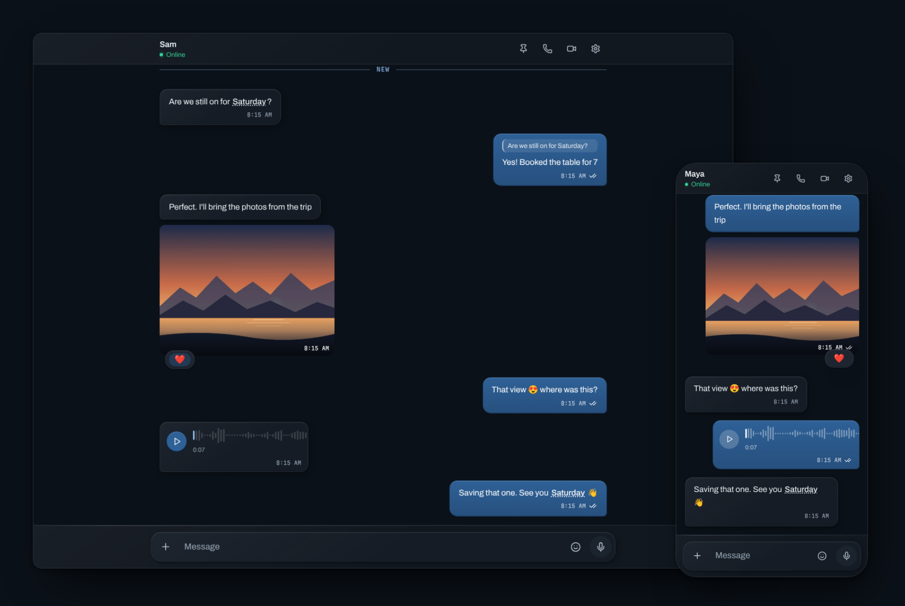
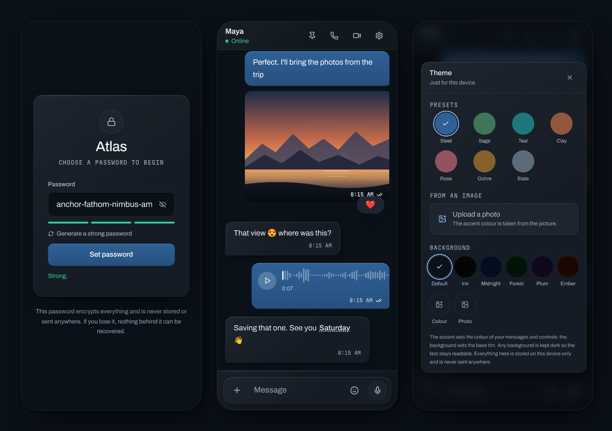

# Atlas

[](https://github.com/realishaanseal/atlas/actions/workflows/ci.yml)

A private, end-to-end encrypted workspace for exactly two people.

Messages, photos, video, files and voice notes are encrypted in the browser
with AES-256-GCM before they touch the network. The server stores ciphertext
and nothing else, and messages expire after 30 days — sooner if you choose.
It runs entirely on free tiers.



**Built with** React 19 · TypeScript · Vite · Tailwind CSS v4 · Web Crypto API ·
WebRTC · Firebase (Firestore, Anonymous Auth, Hosting, Security Rules)

---

## What it does

**Messaging** — real-time, with typing indicators, delivery and read receipts,
online status and last seen. Messages queue in an offline outbox and flush on
reconnect. Edit, schedule up to a week ahead, or set a message to disappear
sooner than 30 days.

**Photos, video and files** — photos are compressed and stripped of EXIF;
video and files are chunked. All of it is encrypted before upload. Drag and
drop, paste, or capture from your camera.

**GIFs** — search Giphy, or send your own. Picked GIFs are downloaded,
encrypted and stored like any other image, so the recipient never contacts
Giphy.

**Voice notes** — up to two minutes, Opus at 24 kbps, with a waveform sampled
live while recording.

**Voice and video calls** — WebRTC, peer-to-peer. Media never touches a server,
and the signalling is encrypted too, so the database never sees an IP address.

**Replies, reactions and pins** — swipe right on touch or hover on desktop to
reply. React with any emoji, pin what matters, and search the conversation —
on-device, without asking the server anything.

**Your own look** — accent and background themes, a shared custom emoji pack,
and doodles drawn straight onto messages.

**A keepsake** — one side keeps a local archive that outlives the 30-day
expiry, and can export it as a single HTML file that opens offline, forever.

**Two people, nobody else.** No accounts, no signup, no groups. One side can
link up to three of their own devices.



---

## Requirements

- Node.js 20.19+ (or 22.12+)
- A Firebase project on the free Spark plan
- Optionally, a free Giphy API key for GIF search

## Quick start

```bash
npm install
cp .env.example .env.local     # then fill in your Firebase config
npm run dev
```

Open http://localhost:5173.

## Commands

| Command             | What it does                                          |
| ------------------- | ----------------------------------------------------- |
| `npm run dev`       | Dev server with HMR                                   |
| `npm run deploy`    | Build, deploy Security Rules, publish hosting         |
| `npm run build`     | Type-check, then production build to `dist/`          |
| `npm test`          | Crypto test suite                                     |
| `npm run typecheck` | Type-check without emitting                           |
| `npm run lint`      | ESLint                                                |
| `npm run rules:deploy` | Deploy Security Rules only                         |

`npm run deploy` is the one you want. Rules and code go out together, which
stops them drifting apart.

---

## Firebase setup

1. Create a project at [console.firebase.google.com](https://console.firebase.google.com). Disable Google Analytics — it's an unnecessary third-party origin.
2. Add a **Web app**; copy the config values into `.env.local`.
3. **Firestore Database → Create database.** *Standard edition*, database ID `(default)`, *production mode*, region nearest you. The region is permanent.
4. **Authentication → Get started → Sign-in method → Anonymous → Enable.**
5. Deploy and publish:
   ```bash
   npm run deploy
   ```
6. **Authentication → Settings → Authorized domains** → add your hosting domain (`your-project.web.app`). Anonymous sign-in is refused from unlisted domains, and the app cannot distinguish that from a slow network — it just hangs.

> **Three Firebase features this project deliberately does without**, because
> all three require the paid Blaze plan: Cloud Storage (encrypted images live
> in Firestore documents instead), Cloud Functions, and native TTL policies.
> Retention is enforced by Security Rules refusing to serve expired documents,
> plus a client-side sweep. See ARCHITECTURE.md §5 for what that does and
> doesn't guarantee.

### Environment variables

All `VITE_`-prefixed values are inlined into the client bundle and are
therefore **public**. That is fine and expected — Firebase web config values
are project identifiers, not credentials. Access control lives in Security
Rules; confidentiality lives in the client-side encryption. Never put a real
secret behind a `VITE_` prefix.

| Variable                            | Required | Where to find it                     |
| ----------------------------------- | -------- | ------------------------------------ |
| `VITE_FIREBASE_API_KEY`             | yes      | Project settings → Your apps         |
| `VITE_FIREBASE_AUTH_DOMAIN`         | yes      | ″                                    |
| `VITE_FIREBASE_PROJECT_ID`          | yes      | ″                                    |
| `VITE_FIREBASE_MESSAGING_SENDER_ID` | yes      | ″                                    |
| `VITE_FIREBASE_APP_ID`              | yes      | ″                                    |
| `VITE_ROOM_ID`                      | yes      | You choose. Any unguessable string.  |
| `VITE_GIPHY_API_KEY`                | no       | developers.giphy.com → Create an App |

Without a Giphy key the GIF button is hidden rather than broken.

---

## Deployment

`npm run deploy` builds, deploys Security Rules, and publishes to Firebase
Hosting in one step. Your site is at `<project-id>.web.app`.

Hosting is free on Spark: 10 GB storage, 10 GB/month transfer. A full
unlocked session is about 330 KB gzipped, and media goes through Firestore
rather than Hosting, so that is roughly 30,000 sessions a month.

Quotas on Spark **block** rather than bill. There is no card attached and no
way to run up a charge.

---

## Security model

The passphrase never leaves the browser. It derives a 256-bit AES-GCM key via
PBKDF2-SHA256 (2,000,000 iterations, public random salt) in a Web Worker,
marked non-extractable so it cannot be read back out even by code running on
the page. Every message is encrypted with a fresh random 12-byte IV. Firebase
receives only `{sender, createdAt, expiresAt, iv, ciphertext}`.

Security Rules enforce document shape, the two-device limit, and refusal to
serve expired documents — but they are a second line of defence, not the
confidentiality boundary. Even a total rules bypass yields ciphertext.

Text is padded to size buckets before encryption, so ciphertext length does
not reveal message length. Images are re-encoded through a canvas, which is
what strips EXIF — phone photos carry GPS coordinates otherwise. Call
signalling is encrypted, so the database never sees an IP address.

**Known limitations, stated plainly:**

- **No forward secrecy.** Anyone who learns the passphrase can decrypt any
  traffic they previously captured. Use a long generated passphrase and share
  it out-of-band exactly once.
- **Deletion depends on someone opening the app.** Rules refuse expired
  documents immediately, but actual deletion happens during a client sweep.
- **Device pairing deters interference; it is not a cryptographic control.**
- **GIFs skip EXIF stripping**, because a canvas re-encode would destroy the
  animation. Giphy results carry no metadata; a GIF from elsewhere might.
- **Search terms in the GIF panel go to Giphy.** Nothing else does.
- **The local archive is not encrypted.** It is a keepsake on one device, on by
  default and pausable under *Chat archive*; anyone with that unlocked device
  can read it.

See [ARCHITECTURE.md](ARCHITECTURE.md) for how it is built and why, and
[SECURITY.md](SECURITY.md) for the threat model.

---

## Licence

Source-available under the [Atlas Non-Commercial Licence](LICENSE): free to
use, study and modify for personal, educational and research purposes, with
credit. Commercial use needs written permission.
